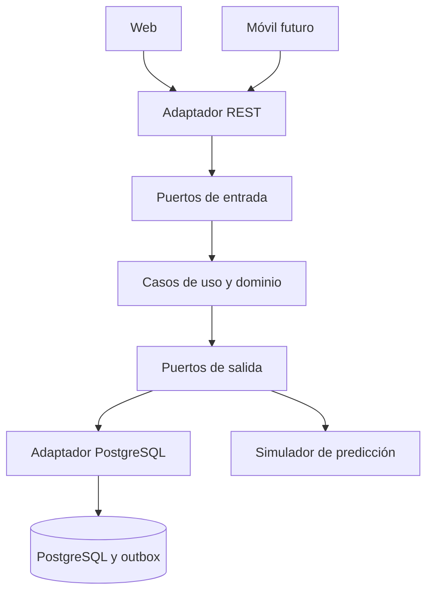

# Decisiones de arquitectura

## Límites

Backend modular desplegado como una aplicación. El incremento 1 comparte paquetes por capa; al crecer,
se agruparán esas mismas capas dentro de los módulos cosecha, calidad, logística y riesgo.
El dominio y aplicación no importan Spring, JDBC ni adaptadores. Spring se limita a infraestructura y adaptadores.
Los puertos de entrada definen las operaciones; los casos de uso los implementan. Los puertos de salida abstraen persistencia, transacciones y predicción.

Las flechas muestran ejecución. Las dependencias de código siempre apuntan al núcleo: los adaptadores implementan interfaces internas.

## Cinco patrones requeridos

| Patrón | Evidencia | Justificación |
|---|---|---|
| Repository | application/ports/output/*RepositoryPort | Los casos de uso no conocen el almacenamiento |
| Dependency Injection | infrastructure/configuration/BeansConfiguration y constructores | Spring conecta implementaciones; el núcleo puede probarse con Java puro |
| Factory Method | domain/factory/EventoFactory | Los creadores Cosecha, Calidad, Riesgo y RiesgoAlto sobrescriben el método fábrica que crea distintos productos EventoDominio |
| Strategy | PrediccionRiesgoPort y SimuladorRiesgoAdapter | El caso de uso recibe el comportamiento de predicción; en pruebas se sustituye por estrategias del umbral y posteriormente podrá usarse un modelo real |
| Adapter | TrazabilidadController, PostgresStore, MemoryStore | Traducen HTTP y persistencia a los contratos del núcleo |

No se mantiene una conexión JDBC global: Spring administra DataSource y su pool.
Las validaciones HTTP no sustituyen las reglas del dominio; ambos niveles rechazan datos inválidos.

## Eventos y consistencia

El estado, la alerta y los eventos se escriben dentro de la misma unidad de trabajo.
PostgresStore utiliza TransactionTemplate; MemoryStore conserva una instantánea para revertir errores durante la demostración.
`outbox_eventos` guarda sobres con eventId, tipo, aggregateId, occurredAt y versión. No guarda una instantánea completa del negocio.

**No hay broker, consumidor ni publicador implementado.** El registro pendiente es la base para incorporar publicación confiable,
pero no demuestra todavía EDA distribuida ni satisface el requisito completo de Kafka.
Antes de integrar Kafka: definir payload versionado, orden por lote, reintentos, política de fallos e idempotencia del consumidor.
El publicador deberá marcar PUBLICADO sólo después del ACK del broker, admitiendo entrega repetida.

## Identidad

Modo local: sin login, menú de demostración sin asignación de permisos.
Modo OIDC: JWT validado y roles del realm de Keycloak; exige configurar issuer-uri y un servidor real.
Reglas de pertenencia a parcelas/lotes aún pendientes: un token de productor no limita hoy los datos a su propietario.
No se presenta esta configuración como autorización completa ni como entorno productivo.

Usuario es el actor general del modelo. Los roles especializados son Productor, Catador, Transportista, Supervisor y Consumidor.
El consumidor accederá a una vista pública QR aún pendiente; no debe recibir acceso al listado interno de lotes.
