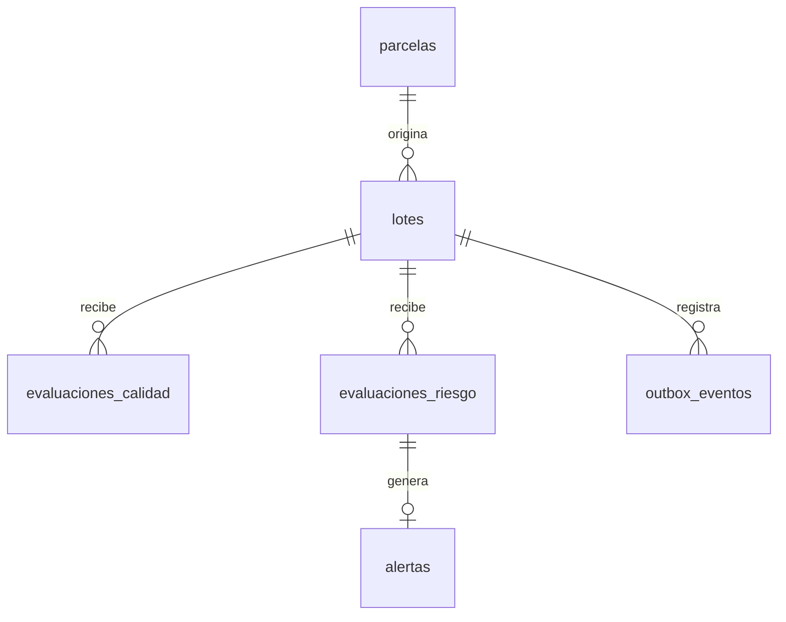

# Modelo de datos del primer incremento

Todas las entidades usan UUID. Las relaciones usan claves foráneas; una alerta referencia la evaluación y su mismo lote.
PostgreSQL conserva instantes de registro con TIMESTAMPTZ. La fecha de cosecha es una fecha de calendario.
Peso usa NUMERIC(11,3); probabilidades y medidas del simulador usan DOUBLE PRECISION, con límites y rechazo de NaN.
No se borran lotes con registros hijos por cascada automática. El prototipo no expone borrado.

La parcela inicial contiene sólo una referencia ficticia de productor. No modela polígonos, historial de titularidad ni EUDR.
La base central todavía no es el esquema completo de todos los RF.

## Evolución prevista, sin crear tablas vacías como si estuvieran implementadas

- Identidad: perfil enlazado al subject OIDC y pertenencia a parcela/cooperativa.
- Producción: procesamiento, mermas, humedad y genealogía de consolidaciones con peso aportado.
- Calidad: ficha física y sensorial completa, actor y auditoría.
- Logística: despacho, checkpoints, incidentes, recepción y firma.
- Telemetría: mediciones con sensor, instante, unidad y relación con envío.
- IA: modelo/versiones, variables usadas, inferencias y revisión humana.
- Pasaporte: certificado, firma, versión y consulta pública limitada por QR.

No almacenar contraseñas de Keycloak en tablas de negocio. No sustituir trazabilidad por un único campo de texto JSON sin relaciones.
